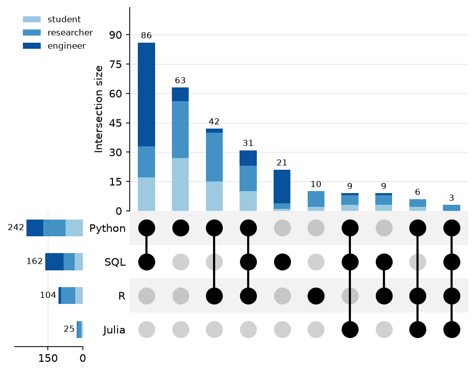

# simpleupset

A small Python package for UpSet plots.



<sub>Made-up survey data; generated by [`docs/readme_example.py`](docs/readme_example.py).</sub>

As the [UpSetPlot](https://github.com/jnothman/UpSetPlot) package seems to be abandoned, I asked Claude to write a quick and simple replacement. The API follows UpSetPlot (`UpSet(data, ...).plot()` takes the same arguments, and `plot` is kept as an alias of `upsetplot`), and it also accepts a plain dict of sets or lists.

This is AI-first code: the problem is simple enough that I don't think it is worth writing by hand, and current models are more than up to the task.

This is an early version. Below 1.0.0 the API is not stable and may change. Please report any issues you find.

## Usage

```python
import matplotlib.pyplot as plt
from simpleupset import upsetplot

upsetplot({"a": [1, 2, 3, 4], "b": [2, 3, 5, 19, 21], "c": [4, 5, 21, 30]}, show_counts=True)
plt.show()
```

Split bars by a group per element with `stack_by`, e.g. `upsetplot(items, stack_by={1: "case", 2: "control", ...})`.

Jupyter shows the plot on its own; VS Code notebooks may need `plt.show()` too. In notebooks, end the line with `;` to hide the returned dict of axes.

Legacy UpSetPlot inputs (a pandas Series or DataFrame with a boolean MultiIndex) also work. pandas is not a dependency.

## Install

Pin a release tag:

```bash
uv add git+https://github.com/openpaul/simpleupset --tag v0.2.0
pixi add --pypi "simpleupset @ git+https://github.com/openpaul/simpleupset@v0.2.0"
```

## Docs

<https://openpaul.github.io/simpleupset/>

The docs include examples small enough to check by hand: each lists its input and the expected intersections next to the generated plot.

## Development

```bash
uv sync
uv run pytest
uv run --group docs sphinx-build docs docs/_build/html
```

## License

Public domain ([Unlicense](LICENSE)). Use it for anything, no attribution needed. No code was taken from UpSetPlot; only its API is mirrored.
